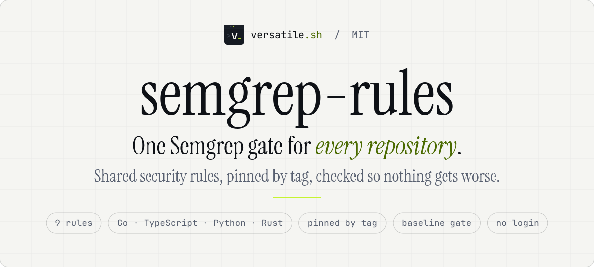
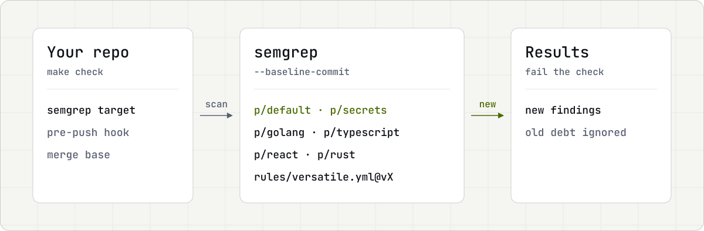

<p align="center">
  <picture>
    <source media="(prefers-color-scheme: dark)" srcset="docs/assets/banner-hero-dark.svg">
    
  </picture>
</p>

<p align="center">
  <a href="LICENSE"></a>
  <a href="https://semgrep.dev"></a>
</p>

<p align="center">
  <b><a href="#quick-start">Quick start</a></b> &nbsp;·&nbsp;
  <b><a href="#usage">Rules</a></b> &nbsp;·&nbsp;
  <a href="#how-it-works">How it works</a> &nbsp;·&nbsp;
  <a href="#configuration">Packs</a> &nbsp;·&nbsp;
  <a href="#development-and-tests">Development</a>
</p>

Shared Semgrep rules for Versatile repositories, published as one rules file per tag, plus the one command a repository runs to gate on "no new findings".

<a id="what-it-is"></a>

<picture>
  <source media="(prefers-color-scheme: dark)" srcset="docs/assets/section-what-it-is-dark.svg">
  
</picture>

semgrep-rules is a single file, [`rules/versatile.yml`](rules/versatile.yml), that a repository loads straight from a tag on GitHub next to the public Semgrep registry packs for its languages. Nothing is copied into the repository, so every repository runs the same rules and a new tag is one line to adopt.

| It does | It does not |
| --- | --- |
| Catch the security mistakes the registry packs miss or word too broadly for us | Replace the registry packs: they run beside it |
| Run without a Semgrep account, login or token | Upload code or send metrics: every command passes `--metrics=off` |
| Gate a branch on the findings it adds, using the merge base as the baseline | Fail a repository for debt it already had |

<a id="how-it-works"></a>

<picture>
  <source media="(prefers-color-scheme: dark)" srcset="docs/assets/section-how-it-works-dark.svg">
  
</picture>

<picture>
  <source media="(prefers-color-scheme: dark)" srcset="docs/assets/diagram-flow-dark.svg">
  
</picture>

1. The repository's check command (and so its pre-push hook) runs its `semgrep` target.
2. Semgrep loads the registry packs for the repository's languages and `rules/versatile.yml` at a pinned tag.
3. `--baseline-commit` set to the merge base with `origin/main` makes Semgrep report only findings introduced since that commit.
4. `--error` turns any new `WARNING` or `ERROR` finding into a failed check.

The baseline is the merge base, not a recorded file. A recorded file keyed on rule and line breaks every time a registry pack adds a rule, because the packs are not versioned; the merge base only ever compares the branch with its own starting point, so a pack update never fails a branch that did not touch the code.

<a id="quick-start"></a>

<picture>
  <source media="(prefers-color-scheme: dark)" srcset="docs/assets/section-quick-start-dark.svg">
  
</picture>

Install Semgrep once, without root:

```sh
pipx install semgrep        # or: uv tool install semgrep, or: python3 -m pip install --user semgrep
semgrep --version
```

Add a target to the repository's check command. A Go repository with a Makefile:

```make
SEMGREP_RULES := https://raw.githubusercontent.com/versatile-sh/semgrep-rules/v0.1.0/rules/versatile.yml

semgrep:
	semgrep scan --metrics=off --disable-version-check --error --severity WARNING --severity ERROR \
		--config p/default --config p/secrets --config p/golang --config $(SEMGREP_RULES) \
		--baseline-commit "$$(git merge-base HEAD origin/main)"
```

A TypeScript repository adds the same command as a `semgrep` script in `package.json` and calls it from its `check` script. The pre-push hook runs the check, and so the scan. Run it on committed work: Semgrep compares commits, so an uncommitted edit is checked once it is committed.

To see the whole debt, run the same command without `--baseline-commit`.

<a id="usage"></a>

<picture>
  <source media="(prefers-color-scheme: dark)" srcset="docs/assets/section-usage-dark.svg">
  
</picture>

| Rule | Languages | Reports | Fix |
| --- | --- | --- | --- |
| `hardcoded-credential-go`, `-js` | Go, TypeScript, JavaScript | A string of 16 or more key-like characters assigned to a name that says secret, token, password, API key, private key or credential | Read the value from configuration at runtime |
| `unsanitized-dangerously-set-inner-html-js` | TypeScript, JavaScript | `dangerouslySetInnerHTML` with a value no sanitizer call wraps | Wrap it in `DOMPurify.sanitize(...)` (or `sanitize`, `sanitizeHtml`) at the call, or render text |
| `shell-string-exec-go`, `-js`, `-py`, `-rs` | Go, TypeScript, JavaScript, Python, Rust | A shell (`sh -c`, `exec`, `shell: true`, `shell=True`) running a string built at runtime | Run the program directly with an argument list |
| `logged-request-secrets-go`, `-js` | Go, TypeScript, JavaScript | A logger call that receives a request's whole headers, one header value, or the body | Log the fields you need |

Reading environment variables outside the composition root is not here: [go-lint](https://github.com/versatile-sh/go-lint) owns it.

<a id="configuration"></a>

<picture>
  <source media="(prefers-color-scheme: dark)" srcset="docs/assets/section-configuration-dark.svg">
  
</picture>

| Repository has | Add |
| --- | --- |
| Any code | `p/default`, `p/secrets`, `rules/versatile.yml` |
| Go | `p/golang` |
| TypeScript | `p/typescript` |
| JavaScript only | `p/javascript` |
| React | `p/react` |
| Rust | `p/rust` |
| Python | `p/python` |
| A `Dockerfile` | `p/dockerfile` |
| No code (media, docs) | `p/secrets` only |

Paths to skip go in a `.semgrepignore` at the repository root, in `.gitignore` syntax. A `.semgrepignore` replaces Semgrep's default list, so keep `node_modules/`, `vendor/` and generated folders in it.

<a id="development-and-tests"></a>

<picture>
  <source media="(prefers-color-scheme: dark)" srcset="docs/assets/section-development-and-tests-dark.svg">
  
</picture>

```sh
make check   # validate the rules, run their test cases, scan this repository, lint the README
make test    # semgrep --validate and semgrep --test on every file in tests/
make images  # regenerate the README images in docs/assets
```

Each rule has cases in `tests/versatile.<ext>`: a `ruleid:` line before code that must be reported and an `ok:` line before code that must not. The README images are generated by `docs/assets/src/build-banners.mjs` from `docs/assets/src/readme.assets.json`; never edit an SVG by hand.

<a id="security-notes"></a>

<picture>
  <source media="(prefers-color-scheme: dark)" srcset="docs/assets/section-security-notes-dark.svg">
  
</picture>

The rules only read source files. The test cases hold synthetic values that are not credentials, and `tests/` is excluded from this repository's own scan. A repository that loads the rules by URL trusts this repository at the pinned tag, so pin a tag, never a branch. Report a vulnerability through a private GitHub security advisory on this repository, not a public issue.

<a id="contributing"></a>

<picture>
  <source media="(prefers-color-scheme: dark)" srcset="docs/assets/section-contributing-dark.svg">
  
</picture>

Open an issue or a pull request. A new rule comes with its cases in `tests/`, a row in the table above, and a new tag; `make check` passes.

<a id="license"></a>

<picture>
  <source media="(prefers-color-scheme: dark)" srcset="docs/assets/section-license-dark.svg">
  
</picture>

Copyright (c) 2026 Versatile (versatile.sh)

semgrep-rules is released under the [MIT License](LICENSE). Contributions are accepted under the same licence.
